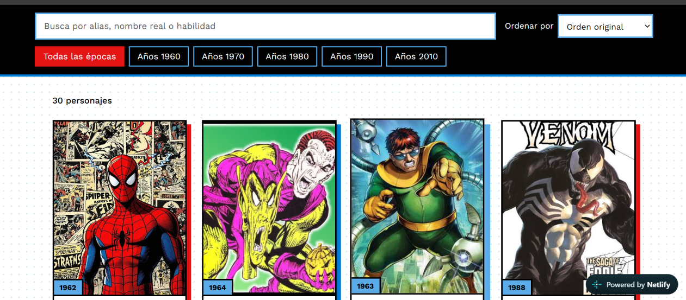
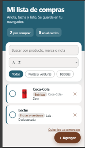

<!-- Presentación -->
<h1 align="center">Javier Juanes Hinojosa</h1>

<h3 align="center">Ingeniero en Sistemas Computacionales | Desarrollo de Software | Redes y Telecomunicaciones</h3>

  Desarrollo soluciones tecnológicas, disfruto resolver problemas y aprender cómo funcionan los sistemas, desde las aplicaciones web hasta la infraestructura de redes.

  
  

---

## Sobre mí

Soy Ingeniero en Sistemas Computacionales con experiencia en desarrollo, mantenimiento y migración de aplicaciones web. He trabajado con Angular, TypeScript, Java, C#, bases de datos SQL y APIs REST, participando en proyectos empresariales y en la integración de servicios.

También he ampliado mi experiencia hacia las redes y las telecomunicaciones mediante actividades de instalación, organización y mantenimiento de infraestructura de comunicaciones en entornos mineros.

Me interesa seguir desarrollando mis habilidades técnicas, aprender nuevas tecnologías y participar en proyectos donde pueda aportar soluciones prácticas y mantener una mejora continua.

- Desarrollo y mantenimiento de aplicaciones web.
- Migración de aplicaciones de Angular 6 a Angular 20.
- Integración de servicios mediante APIs REST.
- Pruebas funcionales, pruebas de regresión y aseguramiento de calidad (QA).
- Instalación y mantenimiento de infraestructura de redes y telecomunicaciones.
- Participación en competencias de programación y actividades de liderazgo tecnológico.

## Tecnologías y herramientas

### Desarrollo de software

  

### Bases de datos, herramientas y plataformas

  

### Redes y telecomunicaciones

- Cableado estructurado e infraestructura de red.
- Instalación y fusión de fibra óptica.
- Ponchado de cable UTP y Jack UTP.
- Instalación de charola tipo Charofil.
- Peinado, organización e identificación del cableado.
- Instalación y mantenimiento de servicios de telecomunicaciones en superficie e interior de mina.
- Apoyo en actividades relacionadas con infraestructura de CCTV y conectividad.

## Experiencia técnica y seguridad industrial

Participación en actividades técnicas y operativas en entornos mineros, siguiendo los procedimientos establecidos para la prevención de riesgos y el trabajo seguro.

- Acreditación del curso de **Trabajo en Alturas**.
- Finalización de la **Inducción Institucional de Seguridad en Unidad Minera Saucito**.
- Aplicación de normas de seguridad industrial.
- Uso adecuado del Equipo de Protección Personal (EPP).
- Cumplimiento de protocolos de trabajo seguro y lineamientos de la unidad minera.

---

## Proyectos destacados

<table>
  <tr>
    <td width="33%" align="center">
      
      <strong>Proyecto 1</strong>
       
      <a href="https://stalwart-boba-68dfeb.netlify.app">Ver proyecto</a>
    </td>
    <td width="33%" align="center">
      
      <strong>Proyecto 2</strong>
       
      <a href="https://famous-nasturtium-6df3e0.netlify.app">Ver proyecto</a>
    </td>
    <td width="33%" align="center">
      
      <strong>Proyecto 3</strong>
       
      <a href="https://thunderous-gumption-d44ff2.netlify.app">Ver proyecto</a>
    </td>
  </tr>
</table>

---

## Formación y logros

- Ingeniería en Sistemas Computacionales.
- Reconocimiento como mejor promedio de mi generación.
- Participación en competencias de programación, incluyendo ICPC Nacional.
- Expresidente del club de programación **CoyotesDev**.

## Actualmente aprendiendo

- Desarrollo backend con Java y Spring Boot.
- Fundamentos de redes IP y telecomunicaciones.
- Infraestructura de fibra óptica y sistemas CCTV.
- Buenas prácticas de desarrollo e integración de servicios.

## Contacto

Estoy abierto a colaborar en proyectos, intercambiar conocimientos y conocer nuevas oportunidades profesionales.

  
  &nbsp;&nbsp;
  
  &nbsp;&nbsp;
  

  <em>Aprendiendo, construyendo y creciendo a través de la tecnología.</em>

